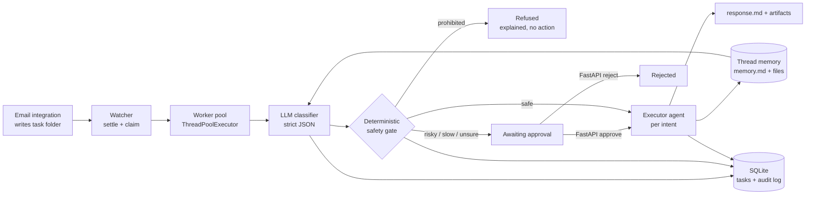

# AI Task Automation Agent

[](https://github.com/Akaashneedsaname/ai-task-automation-agent/actions/workflows/ci.yml)


An agent that reads operational requests arriving by email ("summarise this week's sales", "check this invoice", "update the price of BB-104"), works out what is being asked, does the work, and records everything it did. It also knows when **not** to act on its own: risky tasks wait for a person to approve them, and destructive ones are refused outright.

> **About this repo.** This is a simplified open-source re-implementation of an AI task-automation system I built as an AI Engineer at US Farm Data (2025–2026). The production system processed real business email; this repo uses only synthetic data and omits proprietary integrations.

It runs **fully offline with no API key** (a deterministic mock LLM is the default), so you can clone it and see it work in under a minute. Switch to Claude or OpenAI with one environment variable.

---

## The problem

Small operations teams get a steady stream of email requests that are repetitive but not trivial: pull numbers from a spreadsheet, sanity-check a vendor invoice, find low-stock items, draft a customer reply, change a record. An LLM can do most of this, but handing an LLM direct control is risky:

- it can misread the request and do the wrong thing confidently;
- it can be asked (by a person or a malicious email) to do something destructive;
- arithmetic done "in the model's head" can be silently wrong;
- follow-up emails ("can you also break that down by product?") lose context.

This project shows one way to get the productivity without those failure modes.

## Quickstart

```bash
git clone https://github.com/Akaashneedsaname/ai-task-automation-agent.git
cd ai-task-automation-agent
pip install -r requirements.txt
python -m demo          # processes 10 synthetic emails, no API key needed
python -m pytest        # 31 tests
```

Run the approval API and open the interactive docs at http://127.0.0.1:8000/docs:

```bash
uvicorn --factory task_agent.api:create_app --reload
```

Use a real model instead of the mock:

```bash
pip install -r requirements-llm.txt
cp .env.example .env    # set LLM_PROVIDER=anthropic and ANTHROPIC_API_KEY=...
python -m task_agent watch
```

## Architecture



| Component | File | What it does |
|---|---|---|
| Watcher | `task_agent/watcher.py` | Polls the inbox, waits until a folder stops changing, moves it to `processed/`, submits it to a thread pool. Emails in the same thread run in order; different threads run in parallel. |
| Classifier | `task_agent/classifier.py` | Asks the LLM for strict JSON (intent, plan, time estimate, side effects, confidence), then validates and clamps it. Malformed output is retried, then parked for a human. |
| Safety gate | `task_agent/safety.py` | Plain code, not the model, decides: refuse destructive statements; hold side effects, long jobs, low-confidence guesses and outside senders asking for side effects. |
| Executors | `task_agent/executors.py` | One small agent per intent: sales summary, invoice check, low-stock check, price update, reply draft, meeting invite. |
| Thread memory | `task_agent/memory.py` | Writes `memory.md` per email thread so follow-ups have context and reuse earlier attachments. |
| Store + audit | `task_agent/db.py` | SQLite task state and an append-only audit log (who approved what, when). |
| API | `task_agent/api.py` | FastAPI: list tasks, view one with its audit trail, approve, reject. |

## Sample output

`python -m demo` (abridged):

```
After the first pass
      task                       intent              status             note
OK    01_weekly_sales_summary    sales_summary       completed
OK    02_followup_by_product     sales_summary       completed
OK    03_vendor_invoice          invoice_extraction  completed
OK    04_low_stock_check         inventory_check     completed
HOLD  05_price_update            data_update         awaiting_approval  side effects need sign-off: update_records
OK    06_customer_complaint      draft_reply         completed
HOLD  07_schedule_meeting        schedule_meeting    awaiting_approval  side effects need sign-off: send_calendar_invite
STOP  08_drop_table              data_update         refused            prohibited operation: DROP statement
HOLD  09_quarterly_forecast      sales_summary       awaiting_approval  estimated 120 min > 30 min limit
HOLD  10_vague_request           general_question    awaiting_approval  low classification confidence (0.35)

A manager reviews the held tasks:
  approve 05_price_update   -> completed
  reject  07_schedule_meeting -> rejected

Follow-up email answered from thread memory (no re-attached file):
    - Total revenue: $10,710.00 from 90 units across 8 orders.
    - By region: North $4,042.00, West $3,575.00, South $3,093.00
    - By product: Trail Tent 2P $5,191.00, Hiking Pack 40L $3,808.00, Camp Stove $1,711.00

Invoice check caught a mismatch:
    Line items add up to $847.50 but the invoice states a subtotal of $867.50 (difference $20.00).

Audit trail for 05_price_update:
    received           system                             from sam.okafor@bluebird.example.com: Price change
    classified         system                             intent=data_update est=5m conf=0.90
    held_for_approval  system                             side effects need sign-off: update_records
    approved           ops.manager@bluebird.example.com
    executed           system                             data_update in 0.00s
    completed          system                             outputs in 05_price_update
```

Every task gets a folder in `runtime/demo/output/<task>/` with `response.md`, any artifacts (`figures.json`, `invoice.json`, the updated `price_list.csv`, ...) and `run_info.json`.

## Design decisions

**The model proposes, code decides.** The LLM classifies the request and suggests a plan, but whether anything happens is decided by `safety.py`, a few dozen lines of ordinary, testable code. A cleverly worded email cannot talk its way past a regex for `DROP TABLE`, and the rules are easy to review.

**Human approval for anything with side effects.** Read-only work (summaries, checks, drafts) runs straight through. Changing records, sending invites, long-running jobs (time estimate above a threshold, so costs stay predictable) and low-confidence guesses wait in `awaiting_approval` with the proposed plan written out, so the approver sees exactly what will happen. Approvals and rejections are recorded with the approver's identity.

**Deterministic code where numbers matter.** Totals, invoice arithmetic and reorder quantities are computed in Python. The LLM only turns already-computed facts into readable text, so it cannot invent a figure. This is also how the invoice check catches a vendor subtotal that does not match its own line items.

**Drafts, not sends.** Customer replies are saved as drafts for a person to send. Automating the last step is easy to add later, but costly to get wrong first.

**Memory for follow-ups.** An early version treated every email as a new task: a follow-up like "can you also break that down by product?" had no idea what "that" was and needed the file re-attached. Now each thread keeps a `memory.md` (what was asked, what was found, which files were used) plus a copy of its attachments, and same-thread emails are processed in order so the follow-up always sees the previous answer.

**Failure handling.**
- Malformed model output or a provider error: retry with backoff, then fall back to "needs a human" instead of guessing.
- Bad input (missing attachment, unknown SKU): fail immediately with a clear message; retrying would not help.
- Unexpected exceptions in one task never stop the worker pool.
- Folders are only picked up once they have stopped changing, so half-copied attachments are never read.

**Zero-setup defaults.** SQLite and a mock LLM mean the project runs anywhere with `pip install`. The production system used Postgres and several AI backends; the storage and provider layers are small, so swapping them is straightforward.

## Project layout

```
task_agent/      pipeline code (watcher, classifier, safety, executors, memory, db, api)
demo/            python -m demo
sample_inbox/    10 synthetic emails for a fictional company (*.example.com addresses)
tests/           31 pytest tests, run in CI on Python 3.11-3.13
```

## License

MIT. All names, companies, emails and figures in `sample_inbox/` are fictional.
